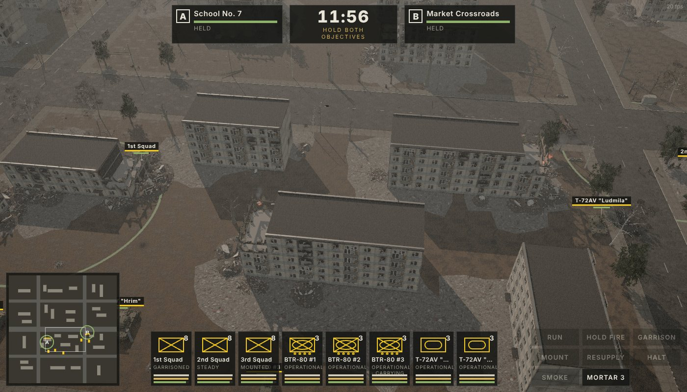
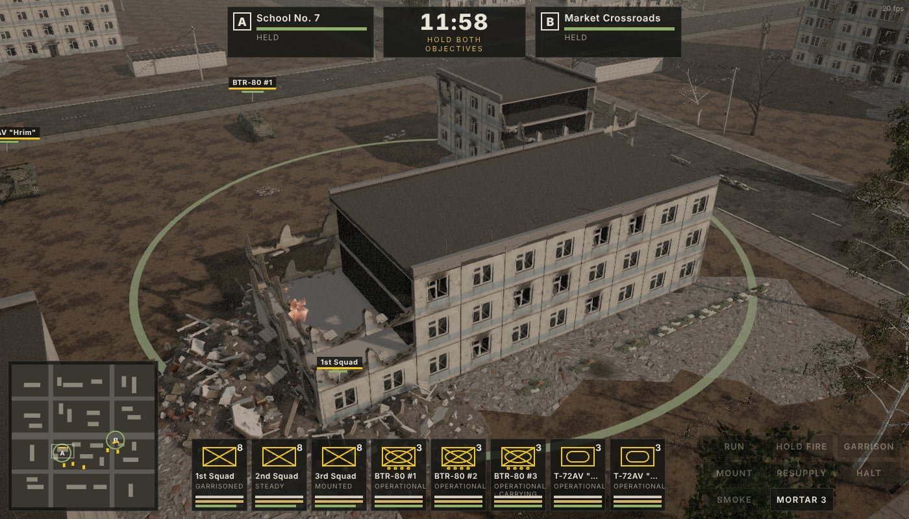
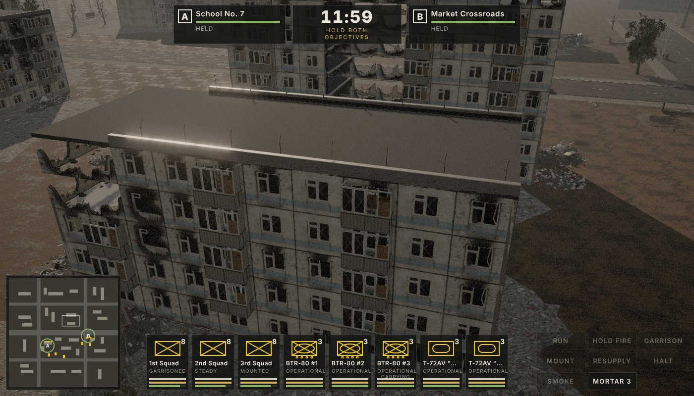
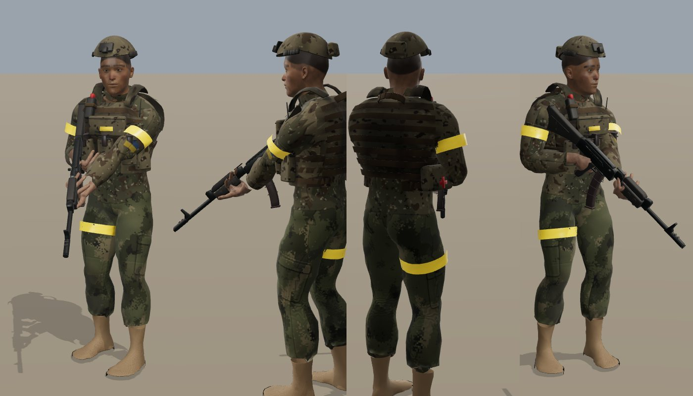
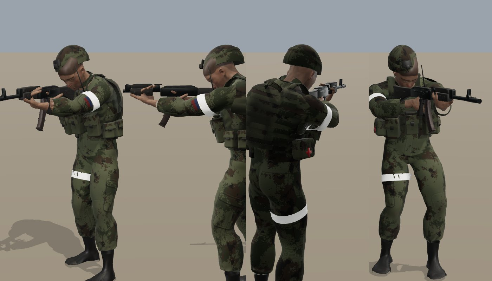
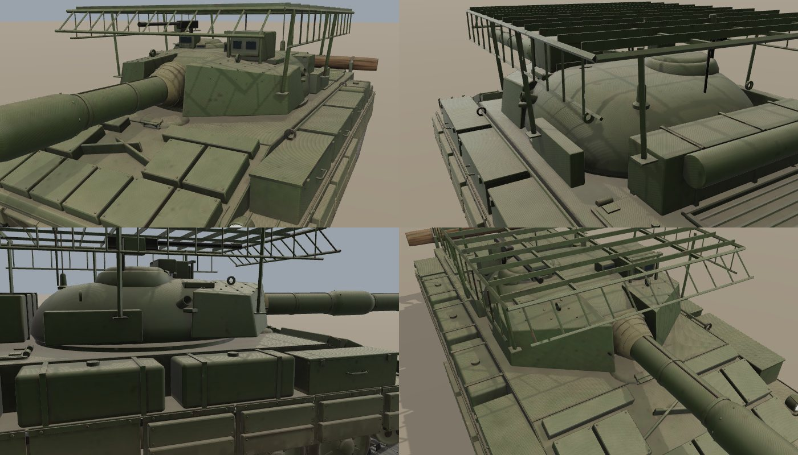
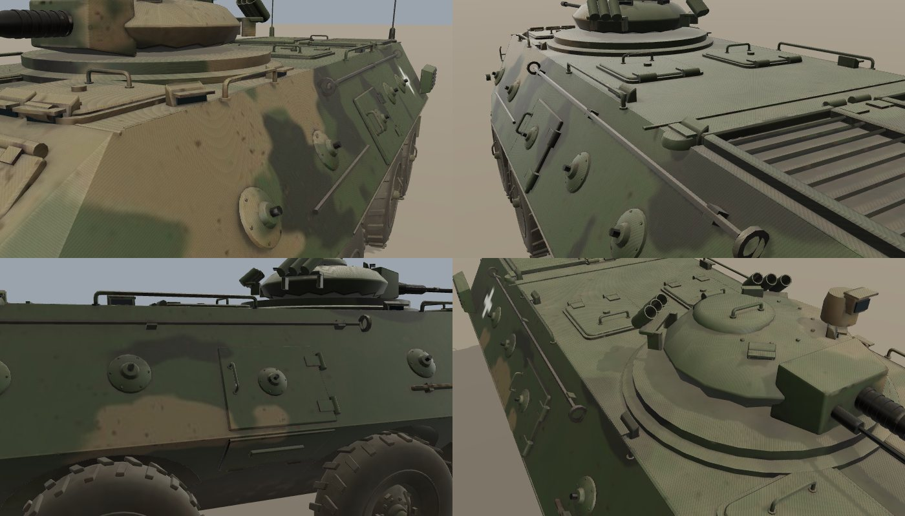
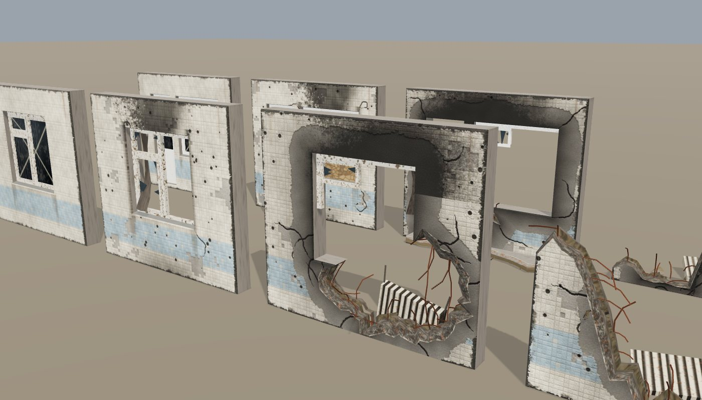
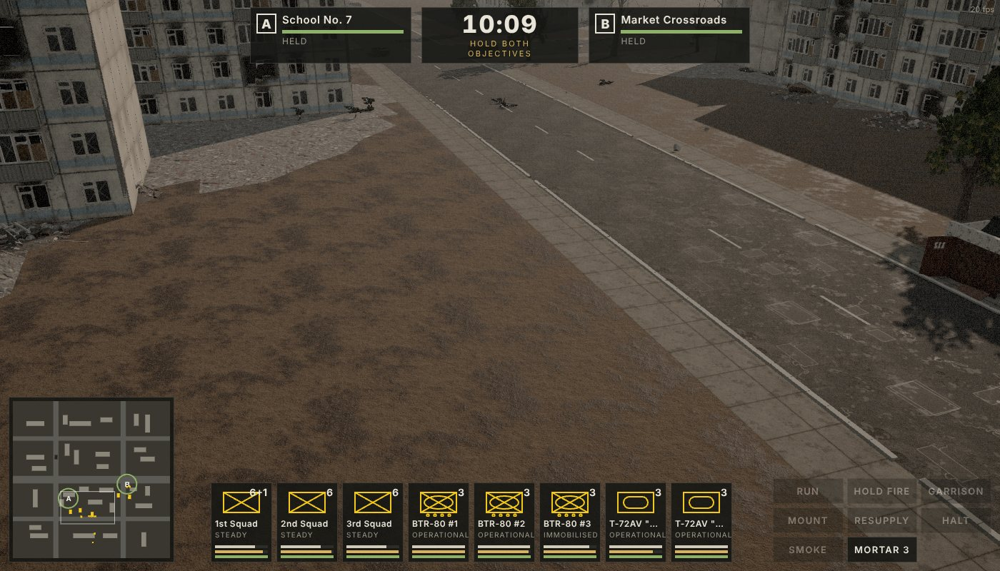

# Special Military Operation — *Hold the Line*

A 3D real-time tactics game in the style of *Napoleon: Total War*, set in a fictional Russo-Ukrainian-style war.
Two maps, picked in the main menu (each card shows its size):

| Map | Size | Setting |
|---|---|---|
| **Novozavodsk** | Medium · 520 × 520 m | Shelled-out Soviet panel-block microdistrict — collapsible blocks, garrisons, street fighting |
| **Novomykolaivka Fields** | Large · 900 × 900 m | Steppe farmland cut by tree-line windbreaks, two villages, a kolkhoz farm, cratered fields, sunflower and maize cover |
 Runs in the browser (Three.js / WebGL2, no build step).

You command a motorized rifle company — three 8-man squads riding on their BTRs, a 6-man assault squad riding on the
lead tank, and a two-tank section. **Deploy** your units in the southern staging ground while the enemy AI deploys in
the north, then **capture Objective A (School No. 7) and Objective B (Market Crossroads)** and **hold both** to the end
of the round (10–16 minutes) against counterattack waves. Play as Ukraine (yellow tape, BTR-80, T-72AV) or Russia (white tape, BTR-82A, T-72B3).



| | |
|---|---|
|  |  |
|  |  |
|  |  |
|  |  |

## Play
Serve the folder with any static web server and open `index.html`:

```bash
npx serve .            # or: python3 -m http.server 8080
```

GitHub Pages works too (Settings → Pages → deploy from branch `main`, root).

### Controls
| | |
|---|---|
| Deployment | Place units inside the green staging ground (right-click / right-drag teleports them), **M** mounts/dismounts, **Enter** or START BATTLE begins |
| Camera | WASD / arrows / screen-edge pan · Q / E rotate · mouse wheel zoom · middle-drag orbit · Shift = fast |
| Select | Left-click · drag box · Shift adds · double-click selects all of that type · Ctrl+1–9 make group, 1–9 recall · click a unit card |
| Move | Right-click ground · **right-drag** to draw a formation line (Total War style), facing away from the camera |
| Attack | Right-click an enemy |
| Garrison | Right-click a building with infantry selected (or **G**) — squads fight from the windows |
| Mount / dismount | Right-click your BTR (or **M**) |
| Other | **R** run · **F** hold fire · **B** resupply from carrier · **X** halt · **V** smoke grenade toward cursor · **T** 82 mm mortar mission (3 per round) · **Space** pause (orders still work) |

## Systems
- **Limited ammunition** — every soldier carries individual magazines (AK-74M 30-rd, PKM 100-rd belts, RPG-7 rockets with the
  assistant grenadier carrying spares). Men share mags when one runs dry; BTRs carry a finite resupply stock. Tanks track
  APFSDS vs HE-FRAG separately (39 rounds, 22 in the carousel).
- **Infantry on armour** — squads ride on top of BTRs and tanks (and can fire from the deck), jump off to dismount, and take
  casualties if the vehicle is hit. Every squad has an **RPG-22** man; assault squads carry heavier armour, optics and
  lots of grenades and can **storm garrisoned buildings** (stack-up, grenades, room clearing).
- **Morale** — per squad: casualties, a downed squad leader, suppression, being flanked, low ammo and nearby vehicle losses
  drain it; cover, garrisons, nearby friendly armour and the leader restore it. Steady → Holding → Shaken → Wavering →
  **Routing** (squads flee to the rear and can rally).
- **Wounded** — hits are resolved by body region; plates (6B46 / plate carriers) and helmets can stop rounds. Soldiers can be
  lightly wounded (slower, limping, less accurate) or critically wounded (down, bleeding out). Squadmates — the medic first —
  drag casualties to cover or to the BTR for evacuation and treat them.
- **Dynamic damage** — buildings are assembled from Soviet large-panel modules; each panel goes intact → damaged → holed →
  destroyed under fire; whole entrance **sections collapse** when their lower floors are shot out, rubble that changes pathing and cover, and garrison casualties.
  Vehicles resolve armour by facing (front/side/rear) vs kinetic or shaped-charge penetration: crew casualties, fires,
  immobilisation, gun damage, ammunition cook-off (T-72 turret toss), passengers bailing out.
- **Suppression & cover** — directional cover from the navigation grid (walls, rubble, wrecks, sandbags), stance changes,
  hand grenades at close range, smoke screens that block line of sight. Sustained heavy fire **pins** a squad (PINNED
  over its banner): it can't move, its aim collapses, men duck behind walls and pop up for bursts; soldiers at wall
  corners lean out, fire and lean back. Infantry routes hug walls; formations are loose and staggered.
- **Spotting & accuracy** — detection is a meter that fills faster for close, moving or firing units and falls off with
  distance, crops, tree lines (you can see out of a belt, not through it), stance and buildings. Hit chance drops steeply
  with range; tank guns need a ranging shot and are poor against single men at distance.
- **Enemy AI** — timed waves, mounted approach, dismount at staging points, bounding advance through cover with smoke,
  tank overwatch, building clearing, artillery and mortar harassment.

## Assets
Everything is generated by scripts in this repo — regenerate with Blender 5 as a Python module (`pip install bpy`):
- `tools/blender/soldiers/` — MakeHuman (CC0) base mesh and `cmu_mb` rig, uniforms (EMR / MM-14 / Multicam), 6B46 plate carrier,
  helmets, tape armbands, AK-74M / PKM / RPG-7, CMU motion-capture animations.
- `tools/blender/vehicles/` — BTR-82A, BTR-80, T-72B3, T-72AV with damage/wreck variants.
- `tools/blender/env/` — panel-building kit with 4 damage states, rubble, trees, wires, props, ground textures.
- `tools/audio/` — sound library build. Credits: [`docs/AUDIO_CREDITS.md`](docs/AUDIO_CREDITS.md).
- Contract between assets and engine: [`ASSETS_SPEC.md`](ASSETS_SPEC.md). Reference notes: [`docs/RESEARCH.md`](docs/RESEARCH.md).

Missing assets fall back to procedural stand-ins, so the game always runs.

### Headless test mode
`index.html?autostart=1&quality=low&sim=300&autoplay=1` simulates 300 s with an automatic defender and renders one frame;
`node tools/preview.mjs "page:/index.html?..." out.png` captures it.

## Licence
Code: MIT. Audio: per-file licences in `docs/AUDIO_CREDITS.md` (CC0 / CC-BY / CC-BY-SA). MakeHuman data CC0.
CMU motion capture: free for any use. This is a fictional scenario; no real units or events are depicted.
